<div align="center">

<p>
  
</p>


<br/>

<p align="center">
  
  <a href="https://github.com/dib-00?tab=followers"></a>
  
  <a href="https://dibyendu-mondal.vercel.app"></a>
  
</p>

<p align="center">
  <a href="https://dibyendu-mondal.vercel.app"></a>&nbsp;
  <a href="https://www.linkedin.com/in/dibyendu-mondal-71b022285"></a>&nbsp;
  <a href="https://dibyendu-mondal.vercel.app/resume/dibyendu-mondal-resume.pdf"></a>&nbsp;
  <a href="https://x.com/DibyenduMo82951"></a>
</p>

</div>


<a id="about"></a>
<p></p>

<table>
<tr>
<td width="55%" valign="top">

- 🔭 **AI & Automation Engineer** at **SVIST Innovation Lab**, Kolkata: AI solutions, PLC-based industrial automation, embedded AI and IoT
- 🤖 **Technology Department** at **Robostemia**: robotics and STEM training for schools and engineering colleges
- 🚀 Building **KhanaOS**, a cloud restaurant POS running in **20+ outlets**
- 🎓 **B.Tech, Electronics & Communication Engineering**, MAKUT (SVIST)
- 🌐 Bengali · Hindi · English · learning Japanese
- 💬 Ask me about **humanoids, on-device LLMs, embedded systems and SaaS**
- ⚡ **Open for freelance:** embedded AI, robotics and full-stack products

</td>
<td width="45%" valign="top">

```text
┌──────────────────────────────────────────────────────┐
│ OPERATOR ........ Dibyendu Mondal                    │
│ ROLE ............ AI & Automation Engineer           │
│ BASE ............ SVIST Innovation Lab               │
│ ALT.UNIT ........ Robostemia // Technology Dept.     │
│ ORIGIN .......... Kolkata, India                     │
│ EDUCATION ....... B.Tech ECE · MAKUT (SVIST)         │
│ LANGUAGES ....... BN · HI · EN · JP(learning)        │
│ MODE ............ Hardware × AI × Software           │
│ STATUS .......... ● ONLINE // OPEN FOR FREELANCE     │
└──────────────────────────────────────────────────────┘
```

</td>
</tr>
</table>

<a id="what-i-do"></a>
<p></p>

<table>
<tr>
<td width="33%" valign="top">

### ⚙️ MOVE
**Hardware**
PCB design · SMPS · Arduino · ESP32 · Raspberry Pi · sensors · micro-soldering

</td>
<td width="33%" valign="top">

### 🧠 THINK
**AI**
Local LLMs · voice STT/TTS · computer vision · RAG · agentic systems

</td>
<td width="33%" valign="top">

### 🚀 SHIP
**Software**
Next.js · React · Flutter · FastAPI · Supabase · Firebase · Docker

</td>
</tr>
</table>

<a id="projects"></a>
<p></p>

| ID | CODENAME | BRIEFING | STACK |
|:--:|:--|:--|:--|
| `U1` | [**K.I.Y.O.**](https://dibyendu-mondal.vercel.app/projects/kiyo-humanoid) | Humanoid that listens, thinks on-device, answers with its whole body | `Pi 5` `ESP32` `llama.cpp` |
| `U2` | [**AURA**](https://dibyendu-mondal.vercel.app/projects/aura-assistant) | Personal AI OS that verifies who's asking before it acts | `Python` `FastAPI` `pgvector` |
| `U3` | [**KhanaOS**](https://dibyendu-mondal.vercel.app/projects/khanaos) | Cloud restaurant POS, live in 20+ outlets | `Next.js` `Supabase` |
| `U4` | [**Asha**](https://dibyendu-mondal.vercel.app/projects/asha-rescue-robot) | Rescue robot for places people shouldn't go first | `Arduino` `Embedded C` |
| `U5` | [**VakLabs**](https://dibyendu-mondal.vercel.app/projects/vaklabs) | Voice cloning on GPU, local or API tiers | `React` `FastAPI` `CUDA` |
| `U6` | [**Aimtech Tutor**](https://dibyendu-mondal.vercel.app/projects/aimtech-tutor) | Adaptive exam prep that plays like a game | `Flutter` `Firebase` |

**[▶ ACCESS ALL 19 MISSIONS](https://dibyendu-mondal.vercel.app/projects)**

#### 📦 Open source on GitHub

<table>
<tr>
<td width="50%" align="center">

<a href="https://github.com/dib-00/display-tester"></a>

</td>
<td width="50%" align="center">

<a href="https://github.com/dib-00/dm-t-chronos-glow"></a>

</td>
</tr>
</table>

<a id="stack"></a>
<p></p>

<table>
<tr>
<td><b>⚙️ Hardware & embedded</b></td>
<td>


</td>
</tr>
<tr>
<td><b>🧠 AI & vision</b></td>
<td>


</td>
</tr>
<tr>
<td><b>🚀 Web & mobile</b></td>
<td>


</td>
</tr>
<tr>
<td><b>🗄️ Backend, data & cloud</b></td>
<td>


</td>
</tr>
<tr>
<td><b>🎨 3D & tools</b></td>
<td>


</td>
</tr>
</table>

<a id="stats"></a>
<p></p>

<div align="center">

<table>
<tr>
<td align="center" width="25%"><h2>19</h2><sub><code>PROJECTS BUILT</code></sub></td>
<td align="center" width="25%"><h2>4</h2><sub><code>PRODUCTS LIVE</code></sub></td>
<td align="center" width="25%"><h2>20+</h2><sub><code>OUTLETS ON KHANAOS</code></sub></td>
<td align="center" width="25%"><h2>7</h2><sub><code>CERTIFICATES</code></sub></td>
</tr>
</table>


<sub>Most of my work lives in private client and product repos; the full list is on <a href="https://dibyendu-mondal.vercel.app/projects">my portfolio</a>.</sub>

</div>

<a id="activity"></a>
<p></p>

<div align="center">
<picture>
  <source media="(prefers-color-scheme: dark)" srcset="https://raw.githubusercontent.com/dib-00/dib-00/output/github-snake-dark.svg" />
  
</picture>
</div>

<a id="connect"></a>
<p></p>

<p align="center">
  <a href="https://dibyendu-mondal.vercel.app/contact"></a>
</p>

<p align="center">
  <a href="https://dibyendu-mondal.vercel.app/contact"></a>&nbsp;
  <a href="https://www.linkedin.com/in/dibyendu-mondal-71b022285"></a>&nbsp;
  <a href="https://x.com/DibyenduMo82951"></a>&nbsp;
  <a href="https://dibyendu-mondal.vercel.app/resume/dibyendu-mondal-resume.pdf"></a>
</p>

<p align="center">
  
</p>
